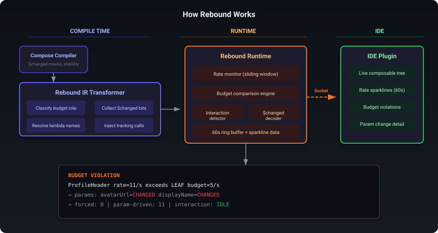
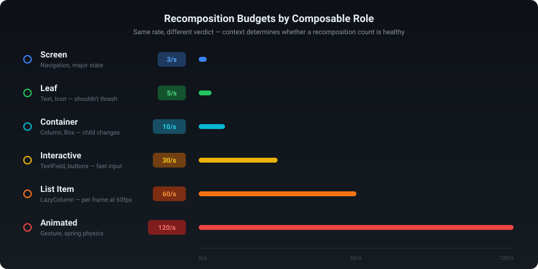
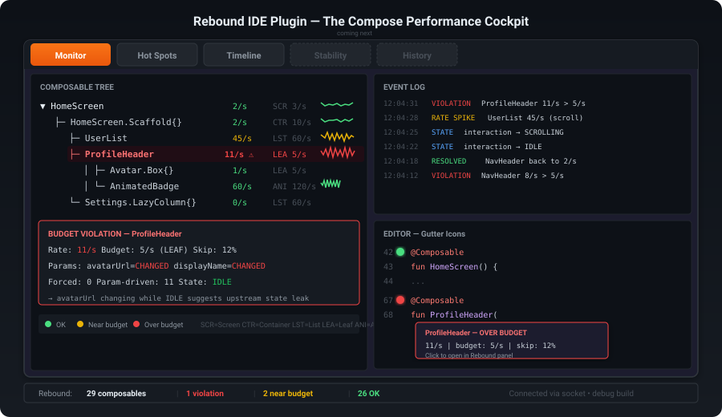

# Rebound

[](https://central.sonatype.com/artifact/io.github.aldefy.rebound/rebound-runtime)
[](https://github.com/aldefy/compose-rebound/releases)
[](LICENSE)
[](https://kotlinlang.org)
[](https://developer.android.com)
[](https://developer.apple.com)
[](https://developer.android.com/jetpack/compose)
[](https://plugins.gradle.org)
[](https://plugins.jetbrains.com)

**Rebound ayuda a los equipos de Android y Compose Multiplatform a detectar regresiones de recomposición antes de publicar.**

Instrumenta cada función `@Composable`, aplica un presupuesto basado en lo que hace ese componible y marca los que comienzan a recomponerse con demasiada frecuencia. Verás el resultado en Android Studio, en la CLI o en logcat. No requiere configuración más allá de aplicar el plugin de Gradle.

## ¿Por qué los equipos lo usan?

- **Pantalla de protección para CI** — falla las compilaciones cuando los presupuestos de recomposición regresan
- **Retroalimentación en el IDE** — inspecciona puntos críticos, picos en la línea de tiempo y problemas de estabilidad sin salir de Android Studio
- **Verificaciones locales rápidas** — usa la CLI para ejecutar flujos de `check`, `snapshot`, `diff` y `watch`

## Características

- **Clases de presupuesto** — clasifica automáticamente los composables (Screen, Container, Interactive, List Item, Animated, Leaf) con presupuestos de tasa apropiados
- **Detección de violaciones** — alerta cuando un componible excede su presupuesto, con registro atenuado para evitar ruido
- **Jerarquía del árbol de llamadas** — rastrea las relaciones padre-hijo de composición
- **Seguimiento de omisiones** — monitorea la tasa de omisión (skip) para identificar composables que se recomponen sin cambios reales
- **Forzadas vs impulsadas por parámetros** — distingue recomposiciones forzadas por el padre de las impulsadas por cambios de parámetros
- **Escala dinámica de presupuestos** — multiplica los presupuestos durante el desplazamiento (2x), animación (1.5x) y entrada del usuario (1.5x)
- **Anotación `@ReboundBudget`** — anula la clase de presupuesto inferida para cualquier componible
- **Detección de regresiones basadas en línea base** — toma instantáneas de métricas antes/después y las compara para detectar regresiones
- **Ventana de herramientas del IDE** — consola de rendimiento de 5 pestañas (Monitor, Puntos Críticos, Línea de Tiempo, Estabilidad, Historial) con integración en el editor (iconos en el margen, incrustaciones CodeVision, widget de barra de estado) y persistencia de sesión
- **CLI** — comandos `doctor`, `check`, `snapshot`, `summary`, `watch`, `ping` sobre el socket ADB

## Inicio rápido

**1. Aplicar el plugin de Gradle**

```kotlin
// settings.gradle.kts
pluginManagement {
    repositories {
        gradlePluginPortal()
        mavenCentral()
    }
}
```

```kotlin
// build.gradle.kts (módulo app)
plugins {
    id("io.github.aldefy.rebound") version "0.2.2"
}
```

**2. Configurar (opcional)**

```kotlin
rebound {
    enabled.set(true)    // predeterminado: true
    debugOnly.set(true)  // predeterminado: true — solo instrumenta compilaciones de depuración
}
```

**3. Ejecutar tu aplicación**

Rebound se instala automáticamente en la primera composición. Las violaciones aparecen en logcat:

```
W/Rebound: [VIOLATION] MyScreen — 8 recomp/s (budget: 3, class: SCREEN)
```

**4. Verificar la ruta en tiempo de ejecución**

Ejecuta la CLI mientras la aplicación de depuración está abierta:

```bash
./rebound-cli.sh doctor   # Diagnostica herramientas, dispositivo, socket y reenvío ADB
./rebound-cli.sh check    # Verifica que ping + instantánea + resumen de datos están fluyendo
./rebound-cli.sh summary  # Principales riesgos de recomposición compartibles para PRs, agentes o CI
```

`doctor` te indica por qué la configuración está rota. `check` prueba que la aplicación es alcanzable y está emitiendo métricas en JSON. `summary` es la salida compacta para pegar en revisiones o automatización.

Conecta el plugin del IDE para una salida en vivo más rica.

### Prueba de ejemplo en 60 segundos

El repositorio incluye una aplicación de ejemplo que viola intencionalmente un presupuesto de recomposición a nivel de pantalla al leer un contador a 60fps en el ámbito `BudgetViolationScreen`.

```bash
./gradlew :sample:installDebug
adb shell am start -n io.aldefy.rebound.sample/.MainActivity

./rebound-cli.sh doctor
./rebound-cli.sh check
./rebound-cli.sh summary
```

Señal esperada: `BudgetViolationScreen` aparece por encima de su presupuesto `SCREEN`. Toca **Fixed** en la aplicación de ejemplo, espera unos segundos y luego ejecuta `summary` nuevamente para ver el estado rápido aislado en un hijo `ANIMATED`.

## Arquitectura



El plugin del compilador inyecta llamadas `ReboundTracker.onCompositionEnter/Exit` en cada función `@Composable` a nivel de IR. El runtime registra las tasas por ventana deslizante y reporta violaciones. El plugin del IDE y la CLI se conectan mediante `LocalServerSocket("rebound")` reenviado a través de ADB (Android) o mediante un puente WebSocket (dispositivos físicos iOS).

> **Compatibilidad con plataformas:** El plugin del compilador instrumenta todos los objetivos KMP. Android usa `LocalServerSocket` + reenvío ADB. El simulador de iOS usa un servidor TCP directo en `:18462`. Los dispositivos físicos de iOS se conectan hacia fuera a un puente WebSocket en Mac mediante auto-detección Bonjour, con registro en consola como respaldo.

## Módulos

| Módulo | Descripción |
|--------|-------------|
| `rebound-runtime` | Biblioteca runtime KMP (Android, iOS, JVM). Transporte completo en todas las plataformas. |
| `rebound-compiler` | Plugin del compilador Kotlin para Kotlin 2.0.x-2.1.x |
| `rebound-compiler-k2` | Plugin del compilador Kotlin para Kotlin 2.2+ |
| `rebound-gradle` | Plugin de Gradle — conecta automáticamente compilador + runtime, selecciona el artefacto correcto |
| `rebound-ide` | Plugin de Android Studio — consola de rendimiento de 5 pestañas con integración en el editor |
| `tools/rebound-relay` | Servidor puente en Mac — conecta dispositivos físicos iOS a CLI/IDE mediante WebSocket |
| `sample` | Aplicación de ejemplo Android con una demostración ejecutable de violación de presupuesto de recomposición |

## Configuración

```kotlin
rebound {
    enabled.set(true)    // Interruptor maestro — establece false para deshabilitar toda la instrumentación
    debugOnly.set(true)  // Solo instrumenta compilaciones de depuración (las compilaciones de lanzamiento no tienen sobrecarga)
}
```

Interruptores en tiempo de ejecución:

```kotlin
ReboundTracker.enabled = true            // Activar/desactivar maestro en tiempo de ejecución
ReboundTracker.logCompositions = false   // Registro en logcat por composición (atenuado 1/s por componible)
```

## Clases de presupuesto



Cada componible se clasifica automáticamente mediante heurísticas de IR:

| Clase de Presupuesto | Tasa/seg | Heurística |
|-------------|----------|-----------|
| `SCREEN` | 3 | El nombre contiene `Screen` o `Page` |
| `CONTAINER` | 10 | Tiene llamadas `@Composable` hijas |
| `INTERACTIVE` | 30 | Predeterminado para no clasificados |
| `LIST_ITEM` | 60 | Dentro de `LazyColumn`/`LazyRow`/`LazyGrid` |
| `ANIMATED` | 120 | Llama a APIs `animate*`/`Transition`/`Animation` |
| `LEAF` | 5 | Sin llamadas `@Composable` hijas |

### Leyenda detallada

#### SCREEN (3/s)

- **Qué son:** Composibles de pantalla completa — la raíz de los destinos de navegación.
- **Heurística:** El nombre contiene `Screen` o `Page`.
- **Por qué 3/s:** Las pantallas solo deberían recomponerse en eventos de navegación o cambios de estado mayores. Si una pantalla se recompones más de 3 veces por segundo, el estado se está filtrando hacia arriba.
- **Ejemplo de violación:** Leer un estado que cambia frecuentemente (por ejemplo, posición de desplazamiento, progreso de animación) a nivel de pantalla en lugar de elevarlo.
- **Solución:** Eleva el estado cambiante al hijo que lo necesita. Usa `derivedStateOf` o mueve las lecturas a un ámbito más pequeño.

#### CONTAINER (10/s)

- **Qué son:** Composibles de diseño con llamadas `@Composable` hijas — Column, Row, Box, ranuras de contenido de Scaffold.
- **Heurística:** Tiene llamadas `@Composable` hijas en su cuerpo.
- **Por qué 10/s:** Los contenedores se recomponen cuando cambia el diseño de los hijos. Se espera una tasa moderada, pero tasas altas sostenidas indican invalidación innecesaria.
- **Ejemplo:** Una Column que se recompones porque el tamaño de un hijo cambió o se está pasando una lambda inestable.

#### INTERACTIVE (30/s)

- **Qué son:** Composibles que responden a la entrada del usuario — botones, campos de texto, controles deslizantes.
- **Heurística:** Predeterminado para composibles no clasificados.
- **Por qué 30/s:** Los usuarios escriben y tocan rápido. Los composibles impulsados por entrada necesitan margen para una UX receptiva.

#### LIST_ITEM (60/s)

- **Qué son:** Elementos dentro de LazyColumn, LazyRow, LazyGrid.
- **Heurística:** Dentro de un ámbito de diseño lazy.
- **Por qué 60/s:** Durante el desplazamiento rápido, los elementos se reciclan a hasta 60fps. Una recomposición por frame es esperada.

#### ANIMATED (120/s)

- **Qué son:** Composibles impulsados por APIs de animación.
- **Heurística:** Llama a APIs `animate*`, `Transition`, `Animation` o `Animatable`.
- **Por qué 120/s:** Las animaciones apuntan a 60-120fps. Este presupuesto da espacio para que la animación se ejecute sin alarmas falsas.

#### LEAF (5/s)

- **Qué son:** Composibles terminales sin llamadas `@Composable` hijas — `Text()`, `Icon()`, `Image()`.
- **Heurística:** Sin llamadas `@Composable` hijas en el cuerpo de la función.
- **Por qué 5/s:** Individualmente económicos pero no deberían sobrecargar la UI. Si un componible hoja se recompones >5/s, algo aguas arriba está empujando cambios de estado innecesarios.

### Codificación de colores

| Color | Condición | Estado |
|-------|-----------|--------|
| Rojo | tasa > presupuesto | EXCEDIDO |
| Amarillo | tasa > 70% del presupuesto | CERCA |
| Verde | tasa <= 70% del presupuesto | OK |
| Gris | no se está recomponiendo activamente | — |

### Escala dinámica

| Estado de interacción | Multiplicador | Efecto |
|---|---|---|
| INACTIVO | 1x | Presupuestos normales |
| DESPLAZAMIENTO | 2x | Presupuestos duplicados durante el desplazamiento |
| ANIMACIÓN | 1.5x | Presupuestos aumentados durante la animación |
| ENTRADA_USUARIO | 1.5x | Presupuestos aumentados durante la entrada |

### Anular con `@ReboundBudget`

```kotlin
// Este componible usa sensor de inclinación — no es una hoja, es animado
@ReboundBudget(BudgetClass.ANIMATED)
@Composable
fun TiltDrivenSticker(offset: Offset) { ... }
```

## Plugin del IDE



El plugin de Android Studio (objetivos 2024.2.1.3+) proporciona una consola de rendimiento de 5 pestañas, integración en el editor y persistencia de sesión. Configura desde Preferencias > Herramientas > Rebound.

### Pestañas

**Monitor** — Árbol de composibles en vivo con historial de tasa tipo minigráfico por nodo. El registro de eventos de desplazamiento en la parte inferior muestra recomposiciones, violaciones y cambios de estado en tiempo real.

**Puntos Críticos** — Tabla plana ordenable de todos los composibles rastreados, clasificada por gravedad (EXCEDIDO > CERCA > OK). Tarjeta de resumen en la parte superior muestra contadores de violaciones/advertencias/OK de un vistazo. Haz clic en cualquier fila para saltar al código fuente.

**Línea de Tiempo** — Mapa de calor componible x tiempo. Cada celda se colorea verde/amarillo/rojo según el estado del presupuesto en ese momento. Desplázate hacia atrás hasta 60 minutos. Útil para correlacionar picos de recomposición con interacciones del usuario.

**Estabilidad** — Matriz de estabilidad de parámetros que muestra estado IGUAL/DIFERENTE/ESTÁTICO/INCERTO por parámetro para cada componible. El árbol de impacto en cascada visualiza cómo los parámetros inestables propagan recomposiciones a través de la jerarquía.

**Historial** — Sesiones guardadas almacenadas en `.rebound/sessions/`. Cada sesión está etiquetada por VCS con nombre de rama y hash de commit. Vista de comparación lado a lado para análisis de regresiones antes/después.

### Integración con el editor

- **Iconos en el margen** — Puntos rojos, amarillos o verdes junto a las declaraciones de funciones `@Composable`, reflejando el estado del presupuesto en vivo.
- **CodeVision** — Pistas en línea sobre cada función componible: `> 12/s | presupuesto: 8/s | EXCEDIDO | omisión: 45%`.
- **Barra de estado** — Widget persistente en la parte inferior del IDE: `Rebound: 45 composibles | 3 violaciones`.

### Conexión

El plugin se conecta mediante `adb forward tcp:18462 localabstract:rebound`. Instálalo desde la salida de compilación de `rebound-ide`.

## CLI

La CLI detecta automáticamente la ruta de conexión: TCP directo (simulador iOS o puente), reenvío ADB (Android) o consola devicectl (dispositivo físico iOS sin puente).

```bash
./rebound-cli.sh doctor     # Diagnostica herramientas, dispositivo, socket y reenvío ADB
./rebound-cli.sh check      # Verificación de ping + instantánea + resumen
./rebound-cli.sh summary    # Top 10 composibles por tasa de recomposición
./rebound-cli.sh snapshot   # Métricas JSON completas para todos los composibles rastreados
./rebound-cli.sh watch      # Actualizaciones en vivo cada 1 segundo
./rebound-cli.sh ping       # Verificación de estado → "pong"
```

O consulta directamente:

```bash
echo "snapshot" | nc localhost 18462
```

### Configuración para dispositivo físico iOS

Para dispositivos físicos iOS, el runtime se conecta hacia fuera a un puente en Mac mediante WebSocket. El dispositivo descubre el puente automáticamente mediante Bonjour.

```bash
# Compila el puente (una sola vez)
./tools/build-relay.sh

# Inicia el puente en tu Mac
./tools/rebound-relay
# → TCP :18462 (CLI/IDE), WebSocket :18463 (dispositivos), Bonjour: _rebound._tcp

# Ahora ejecuta tu app en el dispositivo físico (misma red WiFi)
# El dispositivo descubre y se conecta al puente automáticamente
./rebound-cli.sh snapshot   # funciona transparentemente a través del puente
```

Anula la detección Bonjour con una variable de entorno si es necesario (por ejemplo, una subred diferente):
```
REBOUND_RELAY_HOST=192.168.1.100:18463
```

## Compatibilidad con Kotlin

| Versión de Kotlin | Artefacto del Compilador | Estado |
|---------------|-------------------|--------|
| 2.0.x | `rebound-compiler` | Estable |
| 2.1.x | `rebound-compiler` | Estable |
| 2.2.x | `rebound-compiler-kotlin-2.2` | Estable |
| 2.3.x | `rebound-compiler-kotlin-2.3` | Estable |

El plugin de Gradle detecta automáticamente la versión de Kotlin de tu proyecto y selecciona el artefacto del compilador correcto. No se necesita configuración manual.

## Compatibilidad con plataformas

| Plataforma | Transporte | Estado |
|----------|-----------|--------|
| Android (dispositivo/emulador) | `LocalServerSocket` + reenvío ADB | Estable |
| Simulador iOS | TCP directo en `:18462` | Estable |
| Dispositivo físico iOS | WebSocket → puente Mac (auto-detección Bonjour) | Estable |
| Dispositivo físico iOS (sin puente) | Registro en consola vía `devicectl` | Estable (unidireccional) |
| JVM/Escritorio | En memoria (sin transporte) | Métricas recopiladas, sin exportación |

**¿Por qué múltiples artefactos?** La API de IR del plugin del compilador de Kotlin cambia entre versiones secundarias. Cada artefacto se compila contra el `kotlin-compiler-embeddable` correspondiente para garantizar compatibilidad binaria.

## Hoja de ruta

Consulta [roadmap.md](roadmap.md) para ver la hoja de ruta completa de iOS.

- [x] **Transporte iOS** — servidor TCP (simulador) + puente WebSocket (dispositivo físico) + respaldo en consola
- [x] Puertas de presupuesto en CI — falla compilaciones cuando los presupuestos de recomposición regresan
- [ ] Modo gráfico de llama en la pestaña Línea de Tiempo
- [x] Publicación en JetBrains Marketplace
- [ ] Exportación/importación de sesiones para compartir en equipo
- [x] Instantáneas de línea base para pruebas de regresión
- [ ] Integración ComposeProof para análisis impulsado por LLM
- [ ] Resolución DNS para anulación del host del puente
- [ ] Enrutamiento del puente multi-dispositivo

## Habilidad para Agentes de IA

Haz que tu herramienta de código con IA comprenda el rendimiento de recomposición de Compose. El repositorio **[rebound-skill](https://github.com/aldefy/rebound-skill)** contiene instrucciones basadas en markdown que cualquier asistente de IA puede consumir.

**Lo que cubre:** Clases de presupuesto, diagnóstico de violaciones, análisis de tasa de omisión, optimización de estabilidad, uso de CLI, flujo de trabajo del plugin del IDE — todo respaldado por la base de código real de Rebound.

**Compatible con:** Claude Code, Gemini CLI, Gemini (Android Studio), Cursor, Copilot, Codex, Windsurf, Amazon Q, y cualquier herramienta de IA que consuma markdown.

Consulta [aldefy/rebound-skill](https://github.com/aldefy/rebound-skill) para ver las instrucciones de configuración.

## Documentación

Documentación completa en [aldefy.github.io/compose-rebound](https://aldefy.github.io/compose-rebound/).

## Contribuir

```bash
# Compila todos los módulos
./gradlew build

# Compila el plugin del IDE
./gradlew :rebound-ide:buildPlugin
# Salida: rebound-ide/build/distributions/rebound-ide-0.2.2.zip

# Ejecuta la aplicación de ejemplo
./gradlew :sample:installDebug
```

## Licencia

```
Copyright 2025 Adit Lal

Licensed under the Apache License, Version 2.0 (the "License");
you may not use this file except in compliance with the License.
You may obtain a copy of the License at

    http://www.apache.org/licenses/LICENSE-2.0

Unless required by applicable law or agreed to in writing, software
distributed under the License is distributed on an "AS IS" BASIS,
WITHOUT WARRANTIES OR CONDITIONS OF ANY KIND, either express or implied.
See the License for the specific language governing permissions and
limitations under the License.
```


